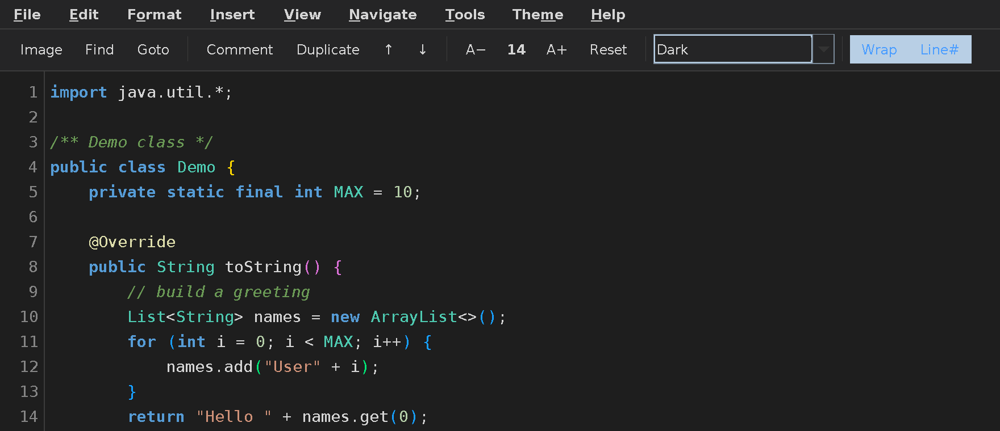
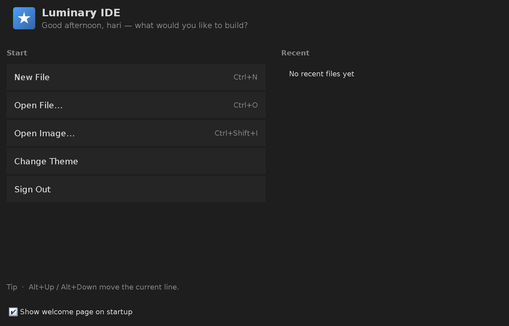
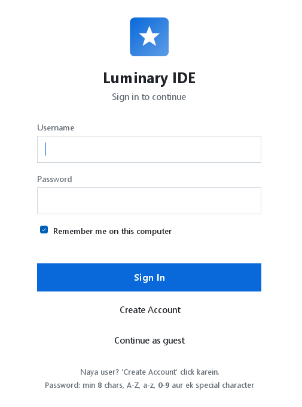

<p align="center">
  
</p>

<h1 align="center">Luminary IDE</h1>

<p align="center">
  <strong>A modern, lightweight desktop text and code editor developed using Java.</strong><br>
  Built with pure Java Swing and AWT — zero third-party dependencies, fast startup, and 12 built-in themes.
</p>

<p align="center">
  
  
  
  
  
</p>

---

## 📖 Overview

**Luminary IDE** fills the gap between basic text editors like Notepad (which lack syntax colors and crash protection) and heavyweight IDEs like IntelliJ or VS Code (which have slow startup times and high memory overhead for quick file edits).

Developed as a single, self-contained Java source file, Luminary IDE delivers a full-featured desktop editing experience with rich theme switching, syntax highlighting, regex find-and-replace, inline image support, and auto-save crash recovery — using nothing outside the standard Java Development Kit (JDK).

---

## 📸 Screenshots

| Main Editor (Dark Theme) | Welcome Screen |
| :---: | :---: |
|  |  |

| Secure Sign-In Dialog |
| :---: |
|  |

---

## ✨ Features

- 🎨 **12 High-Contrast Themes (WCAG AA/AAA Compliant)**:
  - `Light`, `Dark` (VS Code Modern Dark+), `Ocean` (Mariana), `Sunset`, `Forest`, `Dracula`, `Nord`, `Monokai Pro`, `Cyberpunk`, `Solarized Light`, `Solarized Dark`, and `Rosé Pine`.
  - Zero invisible/gray text bugs: All themes feature strictly verified high-contrast foregrounds, gutters, and comment colors. Active typed character attributes dynamically synchronize with the selected theme.
- 🌈 **VS Code-Caliber Colorful Syntax Highlighting**:
  - Full per-token parsing engine supporting **Java, Python, JavaScript, TypeScript, C/C++, HTML/XML, CSS, SQL, and Markdown**.
  - Distinctive semantic coloring: **Control Flow** (magenta/rose), **Keywords** (blue/cyan), **Methods & Invocations** (yellow/gold), **Classes & Types** (teal/mint), **Constants & Enums** (cyan/amber), **Strings** (coral), **Numbers** (sage/lavender), and **Rainbow Brackets** reflecting dynamic nesting depth.
- 🚀 **Integrated Code Runner & Bottom Console Drawer**:
  - Compiles and executes code directly inside Luminary IDE without leaving the editor!
  - Supports **Java** (`javac` + `java`), **Python** (`python -u`), and **JavaScript** (`node`).
  - Collapsible bottom drawer with split-pane docking, process status indicators, execution timer, interactive `stdin` input field, and ANSI stdout/stderr streaming.
- 🖱️ **Interactive Mouse Drag & Hover Visual Feedback**:
  - Custom `IDEButton` and `IDEToggleButton` components with dual `MouseListener` and `MouseMotionListener` integration.
  - Smooth glowing hover pills (`mix(panelBg, accent, 0.24)`), press feedback, glowing accent borders, and continuous tracking during mouse drags.
- 📐 **Reorganized VS Code-Style Menu & Toolbar with Crisp Vector Icons**:
  - Clean IDE menu hierarchy with vector iconography: `File`, `Edit`, `Selection`, `View`, `Run`, `Code`, `Themes`, and `Help`.
  - Grouped Quick Access Toolbar where **every button has a dedicated Java 2D vector icon and descriptive tooltip**:
    - **File Tools**: `New`, `Open`, `Save` (crisp resolution-independent vector documents and folders)
    - **Execution Controls**: `Run` (emerald play triangle), `Stop` (crimson stop square), Language Dropdown with custom language vector badges (`Java`, `Python`, `JS`, etc.)
    - **Search & Navigation**: `Find` (magnifying glass), `Go to` (target line navigation)
    - **Code Manipulation**: `Comment` (code speech bubble), `Duplicate` (overlapping documents), `Up`, `Down` (clean arrows)
    - **View Toggles**: `Wrap` (return wrap arrow), `Line #` (gutter indicator), `Terminal` (command prompt `>_`)
    - **Zoom Controls**: `Zoom -`, Font Size Badge (`14 pt`), `Zoom +`, `Reset` (reload circle)
    - **Theme Switcher**: Two-tone preview color disc swatches for each of the 12 themes!
  - **Zero "Box-Box" / Tofu Glyphs**: Vector icons drawn via `Graphics2D` primitives completely replace fragile Unicode font emojis, ensuring 100% glyph compatibility across all Windows, Linux, and macOS fonts with zero unrenderable square boxes (`□`).
  - **Zero Grey Text in Dropdowns**: Custom `IDEComboBox` with pure solid black text (`#000000`) on light themes, crisp white text on dark themes, smooth rounded pill backgrounds, and custom vector chevrons.
- 🔢 **Line Numbers & Current Line Highlight**: Custom line gutter with current line indicator and active line highlight in the editor.
- ⚡ **Smart Editing Tools**:
  - Auto-indent on Enter
  - Auto-close pairs for parentheses, brackets, braces, and quotes
  - Duplicate Line (`Ctrl+D`)
  - Move Line Up / Down (`Alt+Up` / `Alt+Down`)
  - Toggle Line Comments (`Ctrl+/`) with language-aware comment markers (`//` or `#`)
  - Go to Line (`Ctrl+G`)
- 🔍 **Find & Replace**: Case-sensitive search, regular expression support, live match counter (`1 of 3 matches`), previous/next navigation, and Replace All.
- 🖼️ **Inline Images & Image Viewer**: Paste images from clipboard or drag-and-drop into text; view and inspect images with smooth zoom, 100%, and fit controls.
- 🛡️ **Crash Recovery & Auto-Draft**: Unsaved changes auto-saved to an emergency draft every 20 seconds. On unexpected shutdown, a restore prompt recovers unsaved work.
- 🔐 **Secure Local Authentication**: User registration and login using PBKDF2 with HMAC-SHA256 (120,000 rounds) and random 16-byte salt, accompanied by password validation rules and a Guest Mode.
- 🔊 **Sound Manager**: Synthesized audio feedback for startup, key clicks, saves, theme changes, and errors (fully customizable volume and mute toggles).

---

## ⌨️ Keyboard Shortcuts

| Shortcut | Action |
| --- | --- |
| `F5` / `Ctrl + R` | **Run Code** (Compile & Execute in Terminal Drawer) |
| `Shift + F5` | **Stop Running Process** |
| `Ctrl + \`` | **Toggle Output Terminal Drawer** |
| `Ctrl + N` | New File |
| `Ctrl + Shift + N` | New Window |
| `Ctrl + O` | Open File |
| `Ctrl + S` | Save File |
| `Ctrl + Shift + S` | Save As |
| `Ctrl + Shift + I` | Insert Image |
| `Ctrl + Z` | Undo |
| `Ctrl + Y` / `Ctrl + Shift + Z` | Redo |
| `Ctrl + X` / `Ctrl + C` / `Ctrl + V` | Cut / Copy / Paste |
| `Ctrl + A` | Select All |
| `Ctrl + D` | Duplicate Line |
| `Alt + Up` / `Alt + Down` | Move Line Up / Down |
| `Ctrl + /` | Toggle Line Comment |
| `Ctrl + G` | Go to Line |
| `Ctrl + F` | Find |
| `Ctrl + H` | Replace |
| `Ctrl + +` / `Ctrl + -` | Zoom In / Zoom Out |
| `Ctrl + 0` | Reset Zoom (14 pt) |
| `Esc` | Close Find & Replace Bar |

---

## 🚀 Getting Started

### Prerequisites

- **Java JDK 17** or higher installed (Tested on OpenJDK 17, 21, and 25).
- Ensure `java` and `javac` are available in your system `PATH`.

### Compile and Run

Clone the repository:
```bash
git clone https://github.com/HariAcharyaKhatri/LuminaryIDE.git
cd LuminaryIDE
```

Compile the source code:
```bash
javac -d out src/LuminaryIDE.java
```

Run the application:
```bash
java -cp out LuminaryIDE
```

Open a specific file directly:
```bash
java -cp out LuminaryIDE Demo.java
```

### Running with IntelliJ IDEA, Eclipse, or NetBeans

1. Open the project folder in your IDE.
2. Ensure the project SDK is set to **Java 17+**.
3. Locate `src/LuminaryIDE.java` and click **Run**.

---

## 📁 Project Structure

```
Luminary IDE/
├── assets/
│   ├── logo.svg              # Vector logo
│   ├── logo.png              # High-resolution (512x512) app logo
│   ├── icon-*.png            # Multi-resolution icons (16px to 256px)
│   └── screenshots/          # Application screenshots
│       ├── editor.png
│       ├── login.png
│       └── welcome.png
├── src/
│   ├── LuminaryIDE.java      # Complete application source code
│   └── assets/               # Bundled runtime image assets
├── .gitignore                # Git ignore configuration
├── Luminary IDE.iml          # IntelliJ project module
└── README.md                 # Project documentation
```

---

## 🗺️ Future Architectural Roadmap

To transform Luminary IDE from a lightweight code editor into a state-of-the-art developer environment, the following multi-phase architectural roadmap is planned:

- [ ] **Phase 1: Project Tree Explorer & Multi-Tab Document Workspace**
  - Left dockable directory navigation tree with real-time file system watchers (`WatchService`).
  - Multi-tabbed editor panel allowing simultaneous work across multiple files, split vertical/horizontal panes, and dirty tab indicators (`●`).
- [ ] **Phase 2: Intelligent Code Intelligence & Autocomplete**
  - Contextual code completion popup (`Ctrl+Space`) with keyword suggestions, identifier indexing, and standard library methods.
  - Quick-fix hints, parameter information tooltips, and jump to definition (`F12`).
- [ ] **Phase 3: Integrated Git Gutter & Version Control**
  - Gutter status decorations for added (green), modified (blue), and deleted (red) lines.
  - Side-by-side visual diff viewer and built-in commit / push controls.
- [ ] **Phase 4: Embedded Terminal & Plugin Ecosystem**
  - Native PTY / interactive terminal emulator shell inside the bottom drawer.
  - Modular plugin architecture allowing developers to contribute custom themes, syntax grammars, and tool integrations via clean SPI interfaces.

---

## 🎓 Academic Details

- **Project Title**: Luminary IDE — A Modern Desktop Text and Code Editor Developed Using Java
- **Student**: Hari Khatri (Roll No: BCA307)
- **Course**: Bachelor of Computer Applications (BCA) — 3rd Semester
- **Institution**: Adarsh College of Professional Studies, Department of Computer Science, Aburoad, Rajasthan
- **Project Guide**: Ms. Deepika Kumari Ma'am, Assistant Professor

---

## 👤 Author

- **Hari Khatri**
- **GitHub**: [@HariAcharyaKhatri](https://github.com/HariAcharyaKhatri)
- **Email**: [hariacharyakhatri@gmail.com](mailto:hariacharyakhatri@gmail.com)

---

## 📄 License

This project is open-source and available under the [MIT License](LICENSE).
